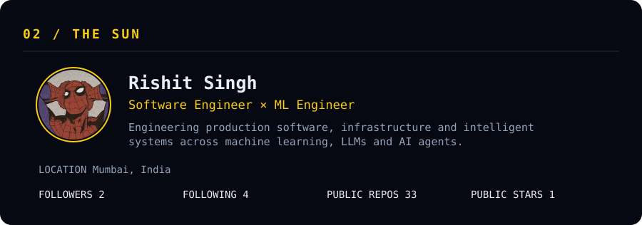
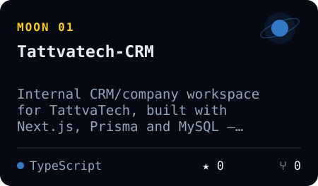
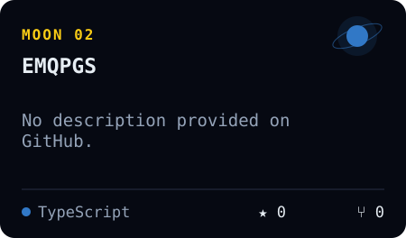
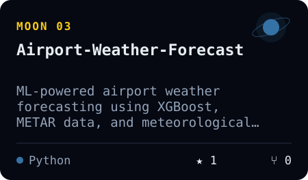
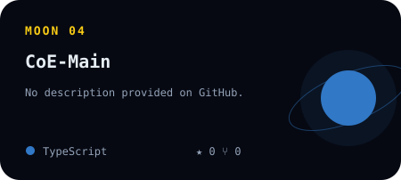
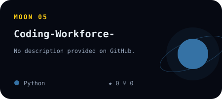
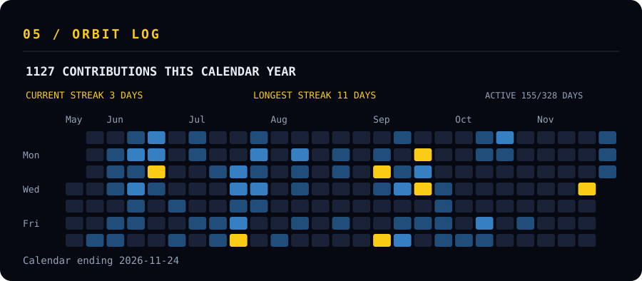

# RISHIT SINGH

**Software Engineer × ML Engineer**

Building products, systems, infrastructure & intelligent software.

## 01 / Solar System

Sun = Developer · Planets = Languages · Moons = Repositories · Comets = Recent pushes

## 02 / The Sun

Engineering production software, infrastructure and intelligent systems across machine learning, LLMs and AI agents.

## 03 / Major Moons

<table>
  <tr>
    <td width="50%"></td>
    <td width="50%"></td>
  </tr>
  <tr>
    <td width="50%"></td>
    <td width="50%"></td>
  </tr>
  <tr>
    <td width="50%"></td>
    <td width="50%"></td>
  </tr>
</table>

## 04 / Planetary Composition

Percentages are calculated from language bytes in public, owned, non-fork, non-archived repositories.

## 05 / Orbit Log

The heatmap shows the latest 26 weeks. The current streak includes today when active, otherwise yesterday. The longest streak is measured over the fetched current calendar year. GitHub reports contribution days in its calendar timezone.

## 06 / Space Stations

**Languages** · TypeScript · JavaScript · Python · Java · C · HTML/CSS · Bash

**Frontend** · Next.js · React · Tailwind · Vite

**Backend** · Node.js · Express · REST APIs · WebSockets · Authentication

**Data** · PostgreSQL · MySQL · Redis · Firebase · MinIO

**Infrastructure** · Docker · AWS · Nginx · Linux · GitHub Actions

**ML** · PyTorch · TensorFlow · Scikit-learn · Pandas · NumPy

**AI agents & automation** · LLM applications · RAG · Agentic workflows · AI automation

## 07 / Mission Log

**2024 → 2028 · Bachelor of Engineering, Artificial Intelligence & Data Science**
Thakur College of Engineering & Technology, Mumbai, India

**Full Stack Web Development Intern · Unified Mentor**
Worked on production-oriented full-stack applications across frontend, backend, databases, APIs, infrastructure and deployment. Projects included RakshaAI and AI Financial Habit Builder.

## 08 / Establish Contact

[Portfolio](https://rishitcodes.in) · [LinkedIn](https://www.linkedin.com/in/rishit-singh-586742361/) · [GitHub](https://github.com/rishit1769)

`TRANSMISSION END // KEEP BUILDING`
